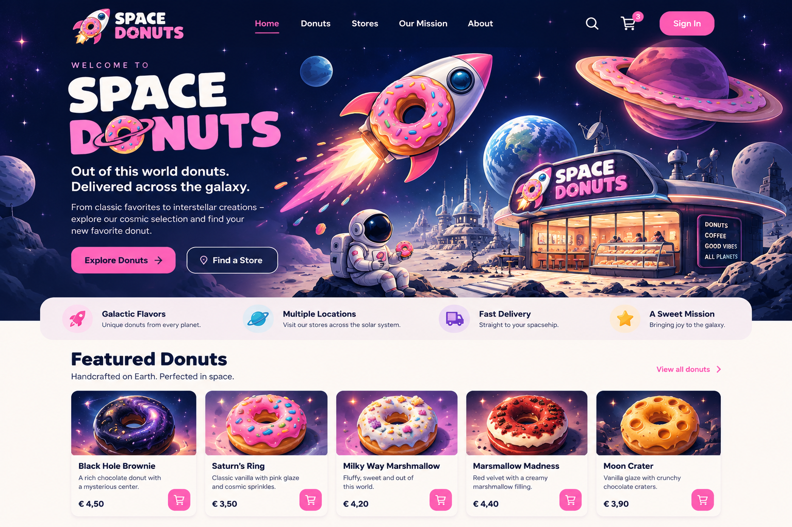

# Space Donuts 🍩🚀

**A fictional galactic donut shop built with Angular 22.**

Space Donuts is a learning project in which I build a fictional online donut shop set in space. The project serves as a practical way to explore modern Angular features, experiment with different approaches, and deepen my understanding of Angular through hands-on development.

Screen Design



## 🎯 Project Goals

The goal is to build a small but realistic web application while exploring modern Angular development.

Topics I plan to cover include:

- Modern Angular architecture and standalone components
- Signals, computed values, and reactive state management
- Component communication and two-way binding
- Angular routing and navigation
- HTTP requests and API integration
- Loading states and error handling
- Forms and user interactions
- Testing and code quality

The application will gradually evolve as new features are introduced.

## 🛠️ Tech Stack

- Angular 22
- TypeScript
- RxJS
- Angular Signals
- Vitest

The stack may evolve as the project grows.

## 📚 Medium Article Series

This repository accompanies a series of articles on Medium documenting the development of Space Donuts.

Each article explores a specific topic, explains the decisions behind the implementation, and links to the relevant code where possible.

**Articles:**

1. Part 1 – From a Blank Project to a Cosmic Storefront  
   [Read on Medium](https://medium.com/@torbengab/building-space-donuts-with-angular-22-part-1-from-a-blank-project-to-a-cosmic-storefront-cdd51723b9fd)

2. Part 2 – From JSON Data to Reusable Components  
   [Read on Medium](https://medium.com/@torbengab/building-space-donuts-with-angular-22-part-2-from-json-data-to-reusable-components-16f42ca76084?sharedUserId=torbengab)

3. Part 3 – Polishing the UI with SCSS and Lucide Icons  
   [Read on Medium](https://medium.com/@torbengab/building-space-donuts-with-angular-22-part-3-polishing-the-ui-with-scss-and-lucide-icons-65296aba8b60?sharedUserId=torbengab)

4. Part 4 – Managing Shopping Cart State with NgRx SignalStore  
   [Read on Medium](https://medium.com/@torbengab/building-space-donuts-with-angular-22-part-4-managing-shopping-cart-state-with-ngrx-signalstore-3df79e614582?sharedUserId=torbengab)

5. Part 5 – Building Reusable Components  
   [Read on Medium](https://medium.com/@torbengab/building-space-donuts-with-angular-22-part-5-building-reusable-components-9968f280ed1f?sharedUserId=torbengab)

6. Part 6 – Building the Shopping Cart and Understanding Computed Signals  
   [Read on Medium](https://medium.com/@torbengab/building-space-donuts-with-angular-22-part-5-building-the-shopping-cart-and-understanding-aa31be48e21a?sharedUserId=torbengab)

## 🚀 Getting Started

### Prerequisites

- Node.js
- npm

### Installation

Clone the repository:

```bash
git clone https://github.com/torbengabriel/space-donuts.git
cd space-donuts
```

Install the dependencies:

```bash
npm install
```

Start the development server:

```bash
npm start
```

Open `http://localhost:4200` in your browser.

### Build

To create a production build:

```bash
npm run build
```

## 📌 Project Status

The project is in its initial setup phase. Features and documentation will be added incrementally.

## 📄 License

No license has been added yet.
