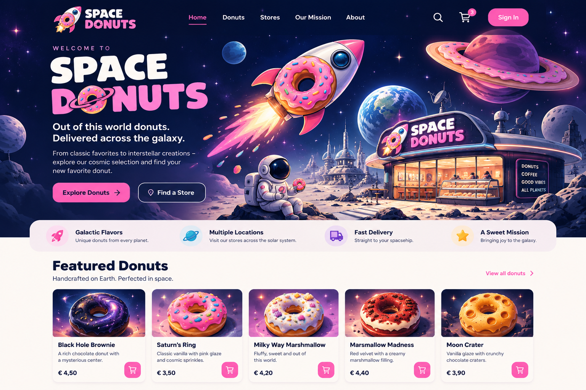

# Space Donuts 🍩🚀

**A fictional galactic product shop built with Angular 22, Spring Boot and modern backend technologies.**

Space Donuts is a full-stack learning project in which I build a fictional online product shop set in space. The project combines a modern Angular frontend with a Java Spring Boot backend and a containerized infrastructure.

The goal is to explore modern web development concepts, experiment with different architectural approaches, and build a realistic application step by step.

## Demo

<!-- Replace the URL below with the GitHub video attachment URL. -->
[Watch the Space Donuts demo](https://github.com/torbengabriel/space-donuts/blob/main/docs/demo/space-donuts-demo.mov)

## Screen Design



## Architecture

Space Donuts is built as a full-stack application with separate frontend, backend and infrastructure components.

- **Frontend:** Angular application for the storefront and user interactions.
- **Backend:** Spring Boot REST API for product management and business logic.
- **Authentication:** Keycloak for authentication and role-based access control.
- **Database:** MySQL for persistent application data.
- **Messaging:** RabbitMQ for asynchronous communication.
- **Real-time communication:** WebSockets for real-time updates.
- **Infrastructure:** Docker Compose for running the required services locally.

## Tech Stack

### Frontend
- Angular 22
- TypeScript
- RxJS
- Angular Signals
- NgRx SignalStore
- Angular Material
- SCSS
- Vitest

### Backend
- Java
- Spring Boot
- Spring Security
- Spring Data JPA / Hibernate
- Flyway
- REST APIs
- WebSockets
- RabbitMQ

### Infrastructure & Services
- Docker & Docker Compose
- MySQL
- Keycloak
- RabbitMQ

## Project Goals

The goal is to build a small but realistic full-stack application while exploring modern development concepts.

Topics include:

- Modern Angular architecture and standalone components
- Signals, computed values and reactive state management
- Component communication and two-way binding
- Angular routing and navigation
- REST API design and integration
- Spring Boot application architecture
- Database design and persistence with JPA
- Database migrations with Flyway
- Authentication and authorization with Keycloak
- Role-based access control
- Asynchronous messaging with RabbitMQ
- Real-time communication with WebSockets
- Docker-based development environments
- Testing and code quality

The application will gradually evolve as new features are introduced.

## Getting Started

Follow these steps to run Space Donuts locally.

### Prerequisites

Make sure the following tools are installed:

- Git
- Node.js (22 or compatible with the project)
- npm
- Docker
- Docker Compose
- Make

### 1. Clone the repository

```bash
git clone https://github.com/torbengabriel/space-donuts.git
cd space-donuts
```

### 2. Configure environment variables

Copy the example environment file:

```bash
cp .env.example .env
```

Open `.env` and configure the required environment variables.

Use local development credentials for your environment. Never commit your actual `.env` file or production secrets.

### 3. Start the backend and infrastructure

Start the services using the Makefile:

```bash
make up
```

This starts the Docker-based environment, including the backend and its required infrastructure services.

### 4. Start the frontend

Open a new terminal in the project root and install the dependencies:

```bash
npm install
```

Start the Angular development server:

```bash
npm start
```

Open the application in your browser:

[http://localhost:4200](http://localhost:4200)

### Useful Commands

| Command | Description |
|---|---|
| `make up` | Start the Docker environment |
| `npm install` | Install frontend dependencies |
| `npm start` | Start the Angular development server |
| `npm run build` | Create a production build |

## 📚 Medium Article Series

This repository accompanies a series of articles on Medium documenting the development of Space Donuts.

Each article explores a specific topic, explains the decisions behind the implementation, and links to the relevant code where possible.

**Articles:**

1. **Part 1 – From a Blank Project to a Cosmic Storefront**  
   [Read on Medium](https://medium.com/@torbengab/building-space-products-with-angular-22-part-1-from-a-blank-project-to-a-cosmic-storefront-cdd51723b9fd)

2. **Part 2 – From JSON Data to Reusable Components**  
   [Read on Medium](https://medium.com/@torbengab/building-space-products-with-angular-22-part-2-from-json-data-to-reusable-components-16f42ca76084?sharedUserId=torbengab)

3. **Part 3 – Polishing the UI with SCSS and Lucide Icons**  
   [Read on Medium](https://medium.com/@torbengab/building-space-products-with-angular-22-part-3-polishing-the-ui-with-scss-and-lucide-icons-65296aba8b60?sharedUserId=torbengab)

4. **Part 4 – Managing Shopping Cart State with NgRx SignalStore**  
   [Read on Medium](https://medium.com/@torbengab/building-space-products-with-angular-22-part-4-managing-shopping-cart-state-with-ngrx-signalstore-3df79e614582?sharedUserId=torbengab)

5. **Part 5 – Building Reusable Components**  
   [Read on Medium](https://medium.com/@torbengab/building-space-products-with-angular-22-part-5-building-reusable-components-9968f280ed1f?sharedUserId=torbengab)

6. **Part 6 – Building the Shopping Cart and Understanding Computed Signals**  
   [Read on Medium](https://medium.com/@torbengab/building-space-products-with-angular-22-part-5-building-the-shopping-cart-and-understanding-aa31be48e21a?sharedUserId=torbengab)

7. **Part 7 – Adding a Floating Cart Button to Our Angular 22 Shop**  
   [Read on Medium](https://medium.com/@torbengab/adding-a-floating-cart-button-to-our-angular-22-shop-b3e40c119ac7?sharedUserId=torbengab)

## Project Status

Space Donuts is an ongoing learning and development project. New features, architectural improvements and technical experiments are added incrementally.

## License

No license has been added yet.
